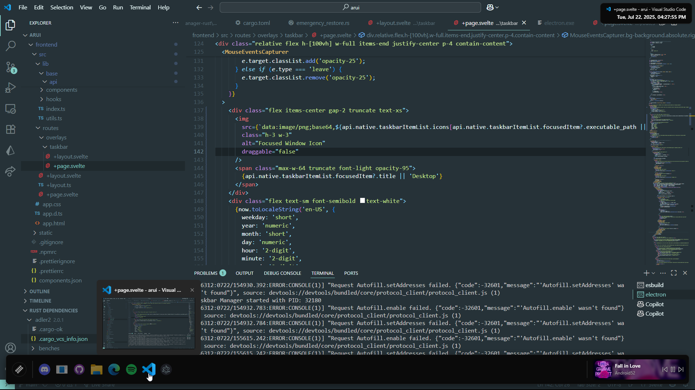

# ARUI <sup>Pre-alpha</sup>

A replacement for the Windows 11 taskbar and start menu, written in Rust and Svelte, where every
piece of the UI is a mod you can restyle, extend or swap out.



ARUI hides explorer's taskbar (explorer itself keeps running) and draws its own per-monitor bars,
start menu, tray, media controls and window previews. It registers real AppBars, so maximized
windows stop at the bar, and it restores the original taskbar when it exits or crashes.

Status: pre-alpha, rewritten from scratch in November 2026. Expect rough edges.

## What works

- Taskbar on every monitor: pinned and running apps grouped by AppUserModelID (UWP and packaged apps
  included), focus/minimize on click, flashing windows, context menus.
- Live window previews on hover (DWM thumbnails).
- Start menu: all Start Menu shortcuts and packaged apps, search, pins, opened by the Windows key.
- System tray: real notification icons (ARUI acts as the tray host), clicks and menus forwarded.
- Media card (any app using system media controls), volume, network status, clock and calendar.
- Mods: themes, widgets in slots, whole replacement surfaces, settings forms, hot reload.
  See [docs/modding.md](docs/modding.md).

## Layout

```
natives/            Rust crates, event driven (Win32 hooks / WinRT events, no polling)
  arui-win          shared types, icon store, helpers
  arui-shell        AppBars, hiding explorer's taskbar, monitors, start menu index, Win key hook
  arui-windows      window tracking, grouping, icons, window actions, DWM previews
  arui-tray         notification area host
  arui-media        system media sessions
  arui-system       volume and network
  arui-guard        watchdog that restores the taskbar if ARUI is killed
renderers/
  shell             Tauri 2 app wiring natives to the UI
  ui                Svelte 5 UI, mod runtime and the built-in mods
  sdk               @arui/sdk: types and components for mods
  create-arui-mod   mod project template
examples/mods/      example mods
legacy/             the previous Electron version, kept for reference
```

## Development

Requirements: Windows 10/11, Rust (stable), Node 22+, pnpm.

```sh
pnpm install
pnpm dev        # builds arui-guard, starts the UI dev server and the Tauri app
```

UI only, in a browser with a mock backend (no taskbar changes):

```sh
pnpm dev:ui     # then open http://localhost:5169/?surface=dev
```

Tests: `cargo test --workspace` and `pnpm -r check`.

If ARUI is killed in a way that also takes down `arui-guard` and your taskbar stays hidden, starting
ARUI again and quitting it from the bar's context menu restores it.

User data lives in `%APPDATA%\ARUI\` (`settings.json`, `mods\`).

## License

GPL-3.0-only
